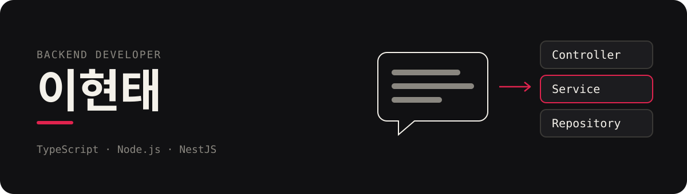

  

안녕하세요, 백엔드 개발자 이현태입니다.
사람과의 소통과 커뮤니케이션을 중시하는, 경청하는 개발자입니다.

## 다루는 문제

### 제품 여권과 공급망 데이터 (2026)

- 의류 디지털 제품 여권(DPP)을 여러 사람이 동시에 편집하고 발행하는 서비스. Yjs 실시간 공동 편집, 공장·제품·Lot을 잇는 공급망 그래프
- 같은 도메인의 다른 플랫폼에서 백엔드·프론트엔드·관리자 콘솔·인프라를 맡음. Terraform으로 dev·상용 두 환경과 CodePipeline 배포를 관리하고, 회원 탈퇴·동의 기록·보유 기간이 지난 데이터 자동 파기까지 처리
- 시험성적서를 QR로 연결해 소비자가 바로 확인하고, QR 라벨 발주까지 처리하는 서비스

### 중고 휴대폰 매입·판매 커머스 (2023–2025)

- 매입 신청, 수거 키트 배송, 검수, 입금, 반송으로 이어지는 주문 상태 흐름과 상태마다 나가는 카카오 알림톡
- 정산 엑셀(KST 기준 날짜 필터), 기종별 카테고리 정렬, 은행 점검 시간 예외 처리, 주문 배치 스케줄러
- 사용자 API, 관리자 API, 배치, 웹 클라이언트 네 저장소에 걸쳐 작업

### 구독 결제 (2025)

- PayPal·PortOne 정기결제 생성, 결제 대기(pending) 상태 처리와 그에 따른 구독 취소

### 개발 운영

- Slack으로 들어온 개발 요청을 Jira 작업으로 접수하고 담당자에게 알려 주는 봇 (AWS Lambda, Terraform)

## 직접 만들어 본 것

- [SingRuler](https://github.com/iflov/singruler): 코인노래방 녹음을 pYIN으로 분석해 내 세션 추세를 보여 주고, 출처가 붙은 연습 피드백을 주는 서비스 (GKE, GCS, RAG)
- [auth-server](https://github.com/iflov/auth-server): MCP 클라이언트용 OAuth 2.1 인증 서버. PKCE, 토큰 교환·리프레시·무효화, 감사 로그 (NestJS, Drizzle)
- [barebones](https://github.com/iflov/barebones): DB와 ORM을 고르면 헥사고날 port·adapter 구조와 로컬 관측 스택(Prometheus, Grafana, Loki)까지 만들어 주는 NestJS 스캐폴드
- k6 부하 테스트 플랫폼: 웹 화면에서 k6 테스트를 설정·실행하고 실시간 지표를 보는 도구 (Next.js, Express, InfluxDB, Kubernetes, ArgoCD)

## 기술

#### Backend

  
  
  
  
  
  

#### Data

  
  
  
  
  

#### Infra · Ops

  
  
  
  
  
  
  

#### Frontend

  
  

